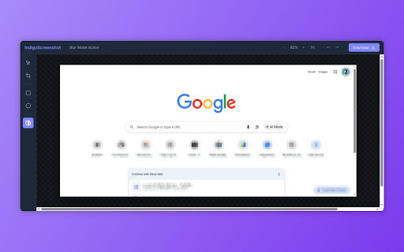

# IndigoScreenshot

A lightweight Chrome extension to capture the visible part of a web page and edit it right away: crop, annotate, blur sensitive information, then download it as PNG.



## Features

- **One-click capture** – click the extension icon to grab the visible area of the current tab; the editor opens in a new tab.
- **Crop** – select an area and apply it, with live width × height display.
- **Shapes** – rectangles and circles with configurable stroke color, stroke width and optional fill.
- **Blur** – hide emails, names, tokens or any other sensitive data.
- **Move & delete** – select shapes to move them, delete them with `Delete` / `Backspace`.
- **Undo / redo** – full history.
- **Zoom & pan** – zoom buttons, fit-to-screen, `Ctrl` + mouse wheel, and space + drag to pan.
- **Download** – export the result as `indigo-screenshot-<timestamp>.png`.
- **Local-first** – screenshots never leave your browser.

## Installation

The extension is not on the Chrome Web Store yet. To install it from source:

1. Clone the repository:
   ```bash
   git clone https://github.com/roberiacono/getscreenshot.git
   ```
2. Open `chrome://extensions` in Chrome (or any Chromium-based browser: Edge, Brave, Arc…).
3. Enable **Developer mode** (top-right toggle).
4. Click **Load unpacked** and select the cloned folder.
5. Pin IndigoScreenshot to the toolbar for quick access.

## Usage

1. Open the page you want to capture.
2. Click the IndigoScreenshot icon.
3. Edit the screenshot in the editor tab that opens.
4. Click **Download**.

### Keyboard shortcuts

| Shortcut | Action |
| --- | --- |
| `Ctrl/Cmd + Z` | Undo |
| `Ctrl/Cmd + Y` or `Ctrl/Cmd + Shift + Z` | Redo |
| `Delete` / `Backspace` | Delete the selected shape |
| `Ctrl/Cmd + mouse wheel` | Zoom in / out |
| `Space + drag` | Pan the canvas |

## Permissions

| Permission | Why it is needed |
| --- | --- |
| `activeTab` | Capture the visible area of the tab you clicked the icon on. |
| `scripting` | Reserved for page interaction. |
| `storage` | Pass the captured image from the background worker to the editor. |

## Privacy

IndigoScreenshot has no analytics, no tracking and no server. Screenshots are processed entirely in your browser and only saved when you click **Download**. The only external request is the editor loading the Inter font from Google Fonts.

## Project structure

```
├── manifest.json   # Extension manifest (Manifest V3)
├── background.js   # Service worker: captures the tab and opens the editor
├── editor.html     # Editor UI
├── editor.js       # Canvas editor: tools, layers, history, zoom/pan
├── styles.css      # Editor styles
└── icons/          # Extension icons (16, 48, 128 px)
```

No build step and no dependencies: plain HTML, CSS and JavaScript. Edit the files, then hit the reload button on the extension card in `chrome://extensions`.

## Contributing

Issues and pull requests are welcome. For larger changes, please open an issue first to discuss what you would like to change.

1. Fork the repository
2. Create a branch: `git checkout -b feature/my-feature`
3. Commit your changes
4. Open a pull request

## License

[MIT](LICENSE) © Roberto Iacono
